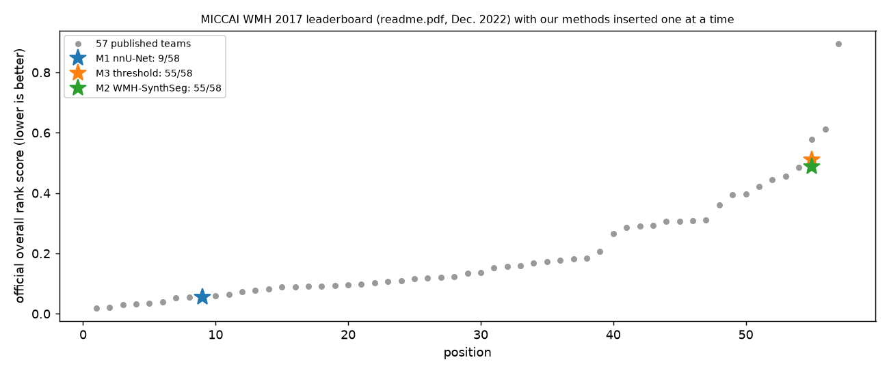

# wmh-multisite

[](https://github.com/JeanBrrt/wmh-multisite/actions/workflows/ci.yml)

**Chaîne reproductible d'analyse multicentrique des hyperintensités de la substance blanche (HSB) en IRM**, des images brutes aux biomarqueurs : contrôle qualité, segmentation, évaluation statistique, biomarqueurs et harmonisation inter-sites.

Données : challenge **MICCAI WMH 2017**, 170 IRM FLAIR + T1 de **5 scanners** sur 3 sites (60 sujets d'entraînement, 110 de test dont 20 issus de 2 scanners absents de l'entraînement).

> [!NOTE]
> **[Rapport complet (PDF, en français)](report/rapport.pdf)** : démarche, méthodes statistiques et ensemble des résultats. Ce README n'en donne qu'un aperçu.

## Questions

Quand les images viennent de centres, d'appareils et de protocoles différents, peut-on :
1. **repérer les images problématiques** avant qu'elles ne faussent la segmentation ?
2. **segmenter les lésions de façon fiable**, y compris sur un scanner jamais vu ?
3. **obtenir des biomarqueurs comparables** d'un site à l'autre ?
4. **retirer l'empreinte du scanner** sans effacer la biologie ?

## Chaîne de traitement

| Étape | Contenu |
|---|---|
| Données | téléchargement DataverseNL (empreintes SHA-1 vérifiées), conversion BIDS |
| Prétraitement | recalage rigide T1 → FLAIR (ANTs), masque du cerveau HD-BET, correction de biais N4, recalage SyN vers MNI152 |
| Contrôle qualité | indicateurs de type MRIQC adaptés à la FLAIR, z-scores robustes par scanner, Isolation Forest, validation par artefacts simulés (TorchIO) |
| Segmentation | **M1** nnU-Net v2 ResEnc M (entraîné sur Kaggle) ; **M2** WMH-SynthSeg (modèle publié) ; **M3** seuillage de la FLAIR |
| Évaluation | script officiel du challenge, bootstrap stratifié par scanner, Wilcoxon / Mann-Whitney / Kruskal-Wallis avec correction de Holm par famille de tests, plafond inter-observateurs |
| Biomarqueurs | volumes total, périventriculaire et profond, nombre de lésions, cartes de fréquence MNI ; accord par Bland-Altman et ICC, biais par site |
| Harmonisation | normalisations d'intensité, classifieur de site, ComBat appris en validation croisée |

## Résultats clés

| Question | Résultat |
|---|---|
| **Segmentation** | M1 : **Dice 0,802** sur les 110 cas de test, **9e sur 58** au classement officiel (2e au Dice, 1er à l'erreur de volume). M3 (0,595) et M2 (0,402) sont 55e. |
| **Scanners inconnus** | Aucune dégradation démontrée pour M1 : Dice −0,015 [−0,066 ; +0,030] sur 20 cas, p = 1 après correction. Avec 20 cas, une petite perte n'est pas exclue. |
| **Plafond humain** | Sur les 12 cas où modèle et experts sont comparables, M1 obtient un Dice de 0,815 contre 0,757 et 0,781 pour deux experts, écart non significatif après correction. |
| **Biomarqueur** | Volume de HSB de M1 : ICC **0,982** avec la référence, au niveau des experts (0,981 et 0,977). Le biais dépend du site, pour M1 comme pour les experts. M2 surestime d'un facteur 2,4. |
| **Harmonisation** | Le scanner est deviné à 90 % depuis la substance blanche saine, 73 % après normalisation, **28 % après ComBat** (hasard 20 %). Le lien avec la charge lésionnelle est conservé. |
| **Contrôle qualité** | Presque toutes les segmentations dégradées par le bruit ou le champ de biais sont signalées (78 sur 83), mais **76 des 99 segmentations dégradées par le mouvement passent inaperçues** (principale limite). |



*Score officiel du challenge des 57 équipes publiées, chaque méthode du projet insérée seule (plus bas = meilleur).*

## Limites

- Un seul pli d'entraînement nnU-Net, sans ensemble (budget GPU).
- 20 cas de scanners inconnus, tous d'Amsterdam ; plafond humain mesuré sur 12 cas de scanners vus.
- Aucune donnée démographique : un écart entre sites peut venir de la population autant que du scanner.
- Le mouvement est mal détecté par le contrôle qualité en FLAIR.

## Reproduire

```bash
uv sync --extra local                                    # environnement verrouillé (Python 3.12)
uv run python -m wmh_multisite.data.download             # ~4 Go depuis DataverseNL
uv run snakemake -s workflow/Snakefile --cores 4         # toute la chaîne locale
uv run pytest                                            # 165 tests, données synthétiques
```

- Deux étapes tournent sur **Kaggle** : les entraînements nnU-Net ([`kaggle/nnunet_training.ipynb`](kaggle/nnunet_training.ipynb)) et WMH-SynthSeg ([`kaggle/wmhsynthseg.ipynb`](kaggle/wmhsynthseg.ipynb)). Le workflow indique quoi lancer si leurs sorties manquent.
- Image Docker CPU : `docker build -f containers/Dockerfile -t wmh-multisite .` (construite par l'intégration continue).
- Tous les paramètres (seuils, grilles, graines, familles de tests) sont dans [`config/config.yaml`](config/config.yaml).

## Organisation du dépôt

```
config/config.yaml          paramètres
src/wmh_multisite/          data, preproc, qc, seg, evaluate, biomarkers, harmonize, viz
workflow/Snakefile          chaîne complète (25 règles)
kaggle/                     notebooks des deux étapes externes
containers/                 Docker, trainers nnU-Net du projet
tests/                      tests pytest
results/tables, figures     résultats agrégés (aucune image de patient)
```

**Outils** : nibabel, SimpleITK, ANTsPy, HD-BET, TemplateFlow, nnU-Net v2, WMH-SynthSeg, PyTorch, TorchIO, scikit-learn, SciPy, pandas, neuroHarmonize, uv, Snakemake, pytest, ruff, GitHub Actions, Docker.

## Références

- Kuijf H.J. et al. *Standardized Assessment of Automatic Segmentation of White Matter Hyperintensities and Results of the WMH Segmentation Challenge.* IEEE TMI, 2019.
- Isensee F. et al. *nnU-Net.* Nature Methods, 2021 ; *nnU-Net Revisited.* MICCAI, 2024.
- Laso P. et al. *WMH-SynthSeg.* ISBI, 2024.
- Esteban O. et al. *MRIQC.* PLoS ONE, 2017.
- Johnson W.E. et al. *ComBat.* Biostatistics, 2007 ; Pomponio R. et al. *neuroHarmonize.* NeuroImage, 2020.

## Licence

Code sous licence MIT ([`LICENSE`](LICENSE)). Données du challenge ([doi:10.34894/AECRSD](https://doi.org/10.34894/AECRSD)) sous licence CC BY-NC 4.0, non redistribuées.
